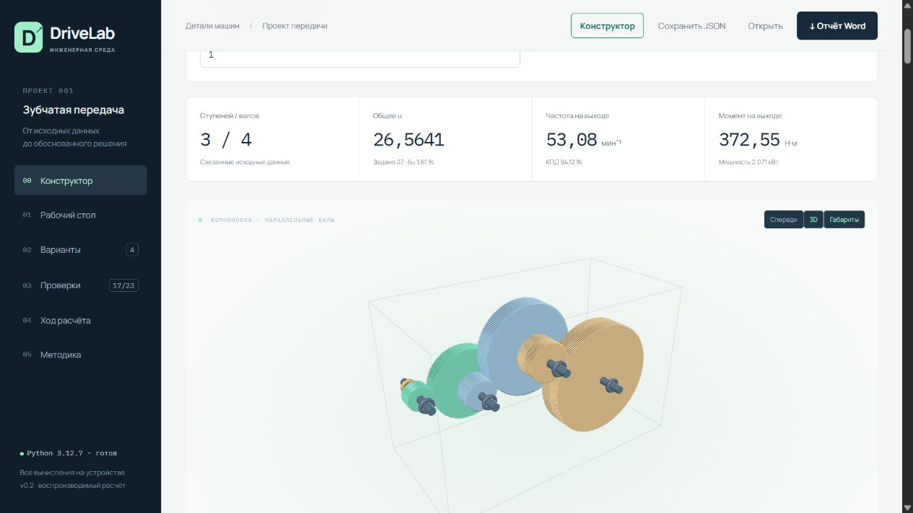
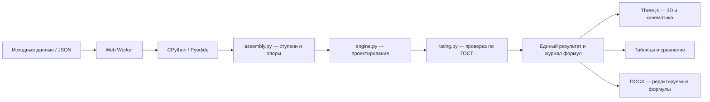

<div align="center">

# DriveLab

**Расчёт цилиндрических передач и компоновка многоступенчатого редуктора.**

Python · WebAssembly · Three.js · ГОСТ 21354–87 · Word

[Открыть конструктор](https://5k4umku.github.io/drivelab/#constructor) · [Руководство](docs/constructor.md) · [Покрытие ГОСТ](docs/gost-coverage.md)

[](https://github.com/5k4umku/drivelab/actions/workflows/ci.yml)


</div>

DriveLab автоматизирует проектировочный расчёт цилиндрической зубчатой передачи: подбирает модуль и числа зубьев, вычисляет геометрию и нагрузки, проверяет прочность и объясняет каждое полученное число. Проект вырос из расчёта по семинарам курса «Детали машин» и развивается в инструмент для курсового проекта привода.



## Что работает

- [Автоматические коэффициенты](docs/coefficients.md): режимы 0–V, симметричный реверс, KA по ГОСТ, точность 6–9, Т5 по фактической компоновке или KHβ/KFβ по заданному полному перекосу. Формулы и источники доступны в интерфейсе и Word.
- Независимый выбор марок сталей и пользовательские характеристики материала; таблица Т1 в редакторе.

- Конструктор последовательного редуктора: добавление и перестановка ступеней, общие промежуточные валы, произвольные направления компоновки и координаты двух опор каждого вала.
- Передача мощности и фактической частоты по цепочке, общий КПД, суммарная ошибка передаточного числа.
- Реакции опор, эпюры изгибающих моментов с учётом осевой силы в полюсе зацепления, предварительная проверка пересечений габаритов.
- Проектировочный расчёт по семинарскому бланку: кинематика, долговечность, допускаемые напряжения, ширина, межосевое расстояние, модуль, зубья, силы.
- Проверочный расчёт по формулам ГОСТ 21354–87: контактная и изгибная выносливость, максимальная нагрузка, нормативные ветви коэффициентов ресурса и перекрытия.
- Прямозубое, косозубое и симметричное шевронное зацепление. Шеврон рассматривается как два косозубых венца с половиной ширины и нагрузки.
- Сравнение модулей и размеров, числовые условия прочности, отдельные статусы применимости.
- Вращающаяся 3D-модель с эвольвентными боковыми поверхностями, действительными диаметрами, числом зубьев, наклоном и отношением скоростей. Визуализация корневого перехода упрощена.
- Редактируемый DOCX: исходные данные, формулы, числовые подстановки, единицы, проверки, источники и допущения.
- Сохранение и загрузка проекта в JSON. Автосохранение в браузере.

В конструкторе можно начать с одной, двух или трёх ступеней и продолжить добавлять их вручную. Входной пример [трёхступенчатого редуктора](examples/reducer-three-stage.json) сочетает косые, прямые и шевронные зубья. Подробные настройки, допущения статики и формат проекта описаны в [руководстве](docs/constructor.md).

**Граница реализации:** это проверяемый учебный инженерный инструмент с явной областью применимости, а не сертифицированный универсальный расчётчик всех случаев ГОСТ. Полная матрица реализованных и неподдерживаемых случаев — в [покрытии ГОСТ](docs/gost-coverage.md). Неизвестные условия никогда не получают зелёный статус автоматически.

## Быстрый запуск

Нужны Python 3.11+ и Node.js 20.11+. Внешние Python-пакеты и сервер базы данных не требуются.

```bash
git clone https://github.com/5k4umku/drivelab.git
cd drivelab
python scripts/fetch-vendor.py
node scripts/build.mjs
node scripts/serve.mjs
```

Откройте `http://127.0.0.1:4173`. При первом запуске браузер загружает около 15 МБ CPython/WebAssembly. Вычисления выполняются на устройстве в отдельном Web Worker. Данные расчёта не отправляются на сервер.

## Проверить расчёт

```bash
python -m unittest discover -s tests -v
python scripts/examples.py
node scripts/test-wasm.mjs
node scripts/test-report.mjs
python src/engine.py examples/helical-seminar.json
```

Проверяются исторический эталон семинара, изменение свойств материалов, замыкание геометрии, баланс мощности, соотношение скоростей, силы, три типа зубьев, независимый численный эталон проверки по ГОСТ, ветви долговечности, границы динамической модели и неправильные исходные данные. Отдельный тест сравнивает результаты нативного CPython с тем же ядром в WebAssembly.

## Инженерный пример

Исходный вариант: `P₁ = 2,2 кВт`, `n₁ = 1410 мин⁻¹`, `u = 6,3`, ресурс 10 000 ч, `KA = 1,25`. Сталь 34ХН3МА: шестерня У785, колесо У685 по правилу двух более мягких строк Т1.

| Показатель | aw = 200 мм | aw = 250 мм |
|---|---:|---:|
| Ширина bw, мм | 32,877 | 41,096 |
| Нормальный модуль, мм | 1,25 | 1,25 |
| Числа зубьев | 43 / 271 | 53 / 334 |
| Контактное напряжение, МПа | 504,93 | 431,34 |
| Допускаемое, МПа | 469,74 | 480,35 |
| Контактная проверка при принятых условиях | Не выполнена | Выполнена |

Изменение размеров вызывает выбор погрешностей по новым диаметрам из Т7 и полный пересчёт. Проектировочная рекомендация по ошибке передаточного числа не подменяет проверку прочности. Коэффициенты по ширине, условия поверхности и число максимальных нагрузок требуют назначения для конкретной конструкции; числовое выполнение не подтверждает эти входные условия.

Готовые входы и полные результаты находятся в [examples](examples/). Исторический расчёт с одинаковой твёрдостью оставлен только как регрессионный тест и не используется как актуальное проектное решение.

## Архитектура



JavaScript управляет интерфейсом, визуализацией и документом. Инженерные вычисления выполняет Python. Расчётное ядро не зависит от браузера и использует только стандартную библиотеку. Размерности зафиксированы на границе модели: мм, Н, Н·м, МПа, кВт, мин⁻¹, ч. Промежуточное округление запрещено.

## Методика

- [Последовательность и решения по реализации](docs/method.md)
- [Формулы и пункты ГОСТ](docs/gost-clauses.md)
- [Область применимости и покрытие случаев](docs/gost-coverage.md)
- [План расширения для курсового](docs/roadmap.md)
- [Выполненные проверки версии](docs/verification.md)
- [Сторонние компоненты](THIRD_PARTY_NOTICES.md)

Официальная [карточка ГОСТ 21354–87](https://protect.gost.ru/gost/details/01aeced3-5fa6-4ed4-becc-02dbddd25624). Текст стандарта и личные фотографии семинаров не включены в репозиторий; в документации приведены ссылки и ссылки на пункты.

## Работа над проектом

Новый расчётный случай добавляется вместе с областью применимости, ссылкой на формулу, независимым численным эталоном и граничными проверками. Для изменения интерфейса достаточно браузерной проверки соответствующего сценария. Коэффициенты не подгоняются для прохождения условий.

Собственный код распространяется по MIT. Лицензии сторонних библиотек сохраняются отдельно.
